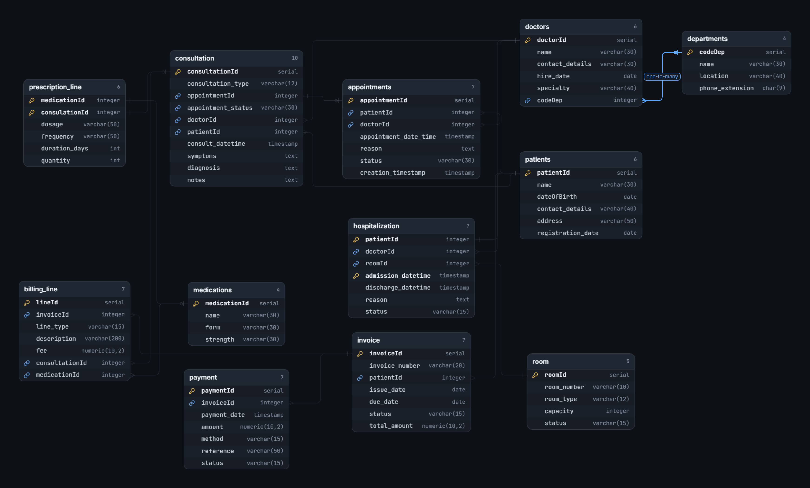

# Hospital Management Database (PostgreSQL)


Relational database for a private hospital, designed from written business rules:
departments, doctors, patients, appointments, consultations, prescriptions, rooms,
hospitalizations, invoices and payments.

The goal is to practise end-to-end data engineering on one realistic domain: modeling,
SQL, analytics, a data warehouse, security and performance. This repository is built in
stages, and each stage is added as a new part.

> **Current status:** Part 1 is done (ER model, relational schema, constraints).
> Later parts are listed in the [roadmap](#roadmap).

## Contents
- [Documentation](#documentation)
- [ER diagram](#er-diagram)
- [Database overview](#database-overview)
- [Design highlights](#design-highlights)
- [How to run](#how-to-run)
- [Known limitations](#known-limitations)
- [Roadmap](#roadmap)
- [Credits](#credits)

## Documentation

| Document | Content |
|---|---|
| [`docs/ER_MODEL.png`](docs/ER_MODEL.png) | Entity-relationship diagram of the operational database |
| [`docs/business_rules.md`](docs/business_rules.md) | Every business rule enforced by the schema, with the constraint that enforces it |
| [`docs/operational_database_schema.sql`](docs/operational_database_schema.sql) | Full PostgreSQL schema: tables, keys and constraints |

## ER diagram



## Database overview

12 tables in 5 functional areas:

| Area | Tables |
|---|---|
| Organization | `departments`, `doctors` |
| Patients and scheduling | `patients`, `appointments` |
| Clinical | `consultation`, `medications`, `prescription_line` |
| Inpatient | `room`, `hospitalization` |
| Billing | `invoice`, `billing_line`, `payment` |

## Design highlights

The main idea is to enforce business rules **inside the database** (keys, CHECKs and
composite foreign keys), not only in application code. The full list is in
[`docs/business_rules.md`](docs/business_rules.md).

| Business rule | How it is enforced |
|---|---|
| A consultation comes from a **completed** appointment; walk-ins and emergencies are allowed | Composite FK `(appointmentId, patientId, doctorId, status)` plus a CHECK, with no trigger |
| The consultation has the same patient and doctor as its appointment | The same composite FK |
| One appointment gives at most one consultation | `UNIQUE` on `consultation.appointmentId` |
| A doctor cannot have two appointments starting at the same time | `UNIQUE (doctorId, appointment_date_time)` |
| A medication appears in many consultations, with its own dosage each time | Associative table `prescription_line` |
| A private room holds exactly one patient | CHECK on `room_type` and `capacity` |
| A stay has a discharge date if and only if it is discharged | CHECK on `status` and `discharge_datetime` |
| An invoice can be paid in several installments | 1:N `invoice` to `payment` |
| Each billing line references only what matches its type | CHECK on `line_type` and the reference columns |

## How to run

Requires PostgreSQL 14+ and `psql`.

```bash
createdb hospital_db
psql -d hospital_db -f docs/operational_database_schema.sql
```

Then check the tables with `\dt` in `psql`.


## Known limitations

These rules are not enforced by constraints, because a `CHECK`, `UNIQUE` or foreign key
only sees one row or one key and cannot count or sum other rows. They require
**triggers**, which I have not learned yet. 
| Limitation | Why a constraint cannot enforce it | Planned solution |
|---|---|---|
| **Room capacity:** a room can receive more patients than its capacity | Needs to count the patients in the room at a given time | Trigger on `hospitalization` |
| **Overpayment:** completed payments can exceed the invoice total | Needs to sum the other payments of the invoice | Trigger on `payment` |
| **Invoice total** is not checked against the sum of its billing lines | Needs to sum rows from another table | Trigger on `billing_line` |
| **Invoice status** is stored, so it can drift from the real payments | Needs to be recalculated each time a payment changes | Trigger on `payment` (or a computed view) |


## Roadmap

| Part | Topic | Status |
|---|---|---|
| A | Conceptual model (ERD) | Done |
| B | Relational model and normalization | Done |
| C | Operational schema (DDL, constraints) | Done |
| C | Synthetic data and constraint tests | Planned |
| D | SQL queries: joins, aggregation, subqueries, CASE | Planned |
| E | Views and materialized views | Planned |
| F | Advanced SQL: CTEs, window functions, dates | Planned |
| G | Data warehouse: star schema, snowflake schema, SCD Type 2 | Planned |
| H | Roles, permissions and row-level security | Planned |
| I | Partitioning and query performance | Planned |
| J | Data quality checks and management analysis | Planned |

## Credits

Based on the *Hospital Management Data Engineering Challenge*
([source](PASTE-LINK-HERE)). All data in this project is synthetic.
