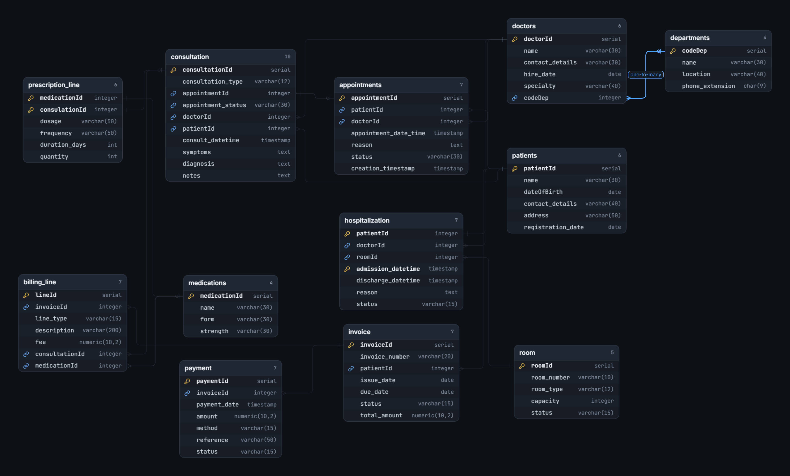

# Hospital Management Database (PostgreSQL)


A data engineering mini-project built around one realistic domain: a private hospital that manages departments, doctors, patients, appointments, consultations, prescriptions, rooms, hospitalizations, invoices and payments.

The project goes from written business rules to a working PostgreSQL database with an analytics layer on top of it:

- **Database design:** a normalized operational (OLTP) schema in which business rules are enforced by keys, constraints and composite foreign keys, not only by application code.
- **SQL analytics:** joins, aggregations, subqueries, `EXISTS` and `CASE` expressions that answer management questions.
- **Views:** normal and materialized views used as a reusable reporting layer.

> **Scope:** this repository covers the conceptual and relational design, the operational schema, SQL querying, and views. A dimensional warehouse, access control and table partitioning are outside the scope of this project.

## Contents

- [Documentation](#documentation)
- [ER diagram](#er-diagram)
- [Database overview](#database-overview)
- [Design highlights](#design-highlights)
- [How to run](#how-to-run)
- [SQL queries](#sql-queries)
- [Views and reusable analytics](#views-and-reusable-analytics)
- [Known limitations](#known-limitations)
- [Credits](#credits)

## Documentation

| Document | Content |
|---|---|
| [`docs/ER_MODEL.png`](docs/ER_MODEL.png) | Entity-relationship diagram of the operational database |
| [`docs/business_rules.md`](docs/business_rules.md) | Every business rule enforced by the schema, with the constraint that enforces it |
| [`docs/operational_database_schema.sql`](docs/operational_database_schema.sql) | Full PostgreSQL schema: tables, keys and constraints |

## ER diagram



## Database overview

12 tables in 5 functional areas:

| Area | Tables |
|---|---|
| Organization | `departments`, `doctors` |
| Patients and scheduling | `patients`, `appointments` |
| Clinical | `consultation`, `medications`, `prescription_line` |
| Inpatient | `room`, `hospitalization` |
| Billing | `invoice`, `billing_line`, `payment` |

## Design highlights

Business rules are enforced **inside the database** (keys, `CHECK` constraints and composite foreign keys). The full list is in [`docs/business_rules.md`](docs/business_rules.md).

| Business rule | How it is enforced |
|---|---|
| A consultation comes from a **completed** appointment; walk-ins and emergencies are allowed | Composite FK `(appointmentId, patientId, doctorId, status)` plus a `CHECK`, with no trigger |
| A consultation has the same patient and doctor as its appointment | The same composite FK |
| One appointment gives at most one consultation | `UNIQUE` on `consultation.appointmentId` |
| A doctor cannot have two appointments starting at the same time | `UNIQUE (doctorId, appointment_date_time)` |
| A medication appears in many consultations, with its own dosage each time | Associative table `prescription_line` |
| A private room holds exactly one patient | `CHECK` on `room_type` and `capacity` |
| A stay has a discharge date if and only if it is discharged | `CHECK` on `status` and `discharge_datetime` |
| An invoice can be paid in several installments | 1:N relationship from `invoice` to `payment` |
| Each billing line references only what matches its type | `CHECK` on `line_type` and the reference columns |

## How to run

Requires PostgreSQL 14+ and `psql`.

```bash
createdb hospital_db
psql -d hospital_db -f docs/operational_database_schema.sql
```

Then check the tables with `\dt` in `psql`.

---

## SQL queries

Queries on the operational database, grouped by topic. Techniques used: `SELECT`/`WHERE`, aggregation, joins, subqueries, `EXISTS`, `CASE`.

### 1. Basic selection and filtering

**1.1 Retrieve all registered patients.**
```sql
select * from patients;
```

**1.2 Display each doctor's name and specialty.**
```sql
select name, specialty from doctors;
```

**1.3 Find patients born after 1 January 2000.**
```sql
select patientId, name, dateOfBirth
from patients
where dateOfBirth > '2000-01-01';
```

**1.4 Find confirmed appointments.**
```sql
select * from appointments
where status = 'confirmed';
```

**1.5 Display the most recent appointments first.**
```sql
select * from appointments
order by appointment_date_time desc;
```

**1.6 Find appointments within a date range (all of November 2026).**
```sql
select * from appointments
where appointment_date_time >= '2026-11-01'
  and appointment_date_time <  '2026-12-01'
order by appointment_date_time;
```

**1.7 Find patients whose phone number is missing.**
```sql
select patientId, name
from patients
where contact_details is null;
```
*Assumption:* the schema has no separate phone column, so missing `contact_details` is treated as a missing phone number.

### 2. Aggregation

**2.1 Count all registered patients.**
```sql
select count(*) as nb_patients from patients;
```

**2.2 Count appointments by status.**
```sql
select status, count(*) as nb_appointments
from appointments
group by status
order by nb_appointments desc;
```

**2.3 Count doctors in each department.**
```sql
select d.name as department, count(doc.doctorId) as nb_doctors
from departments d
left join doctors doc on doc.codeDep = d.codeDep
group by d.codeDep, d.name
order by nb_doctors desc;
```
The `left join` keeps departments that have no doctors (count 0).

**2.4 Find departments with more than three doctors.**
```sql
select d.name as department, count(doc.doctorId) as nb_doctors
from departments d
left join doctors doc on doc.codeDep = d.codeDep
group by d.codeDep, d.name
having count(doc.doctorId) > 3;
```

**2.5 Count appointments per doctor, including doctors with zero appointments.**
```sql
select doc.doctorId, doc.name, count(a.appointmentId) as nb_appointments
from doctors doc
left join appointments a on a.doctorId = doc.doctorId
group by doc.doctorId, doc.name
order by nb_appointments desc;
```

**2.6 Calculate total payments received per month.**
```sql
select date_trunc('month', payment_date) as month,
       sum(amount) as total_received
from payment
where status = 'completed'
group by date_trunc('month', payment_date)
order by month;
```
Only `completed` payments count as received. Pending, failed and refunded payments are excluded.

**2.7 Find patients with more than two appointments.**
```sql
select p.patientId, p.name, count(a.appointmentId) as nb_appointments
from patients p
join appointments a on a.patientId = p.patientId
group by p.patientId, p.name
having count(a.appointmentId) > 2;
```

### 3. Joins

**3.1 Display appointments with patient and doctor names.**
```sql
select a.appointmentId, a.appointment_date_time, a.status,
       p.name as patient, d.name as doctor
from appointments a
join patients p on p.patientId = a.patientId
join doctors  d on d.doctorId  = a.doctorId
order by a.appointment_date_time;
```

**3.2 Display doctors with their department names.**
```sql
select doc.doctorId, doc.name as doctor, doc.specialty, dep.name as department
from doctors doc
join departments dep on dep.codeDep = doc.codeDep;
```

**3.3 Retrieve consultations with patient and doctor details.**
```sql
select c.consultationId, c.consultation_type, c.consult_datetime,
       p.name as patient, d.name as doctor, d.specialty,
       c.symptoms, c.diagnosis
from consultation c
join patients p on p.patientId = c.patientId
join doctors  d on d.doctorId  = c.doctorId
order by c.consult_datetime;
```

**3.4 Display hospitalization records with room information.**
```sql
select h.patientId, h.admission_datetime, h.discharge_datetime, h.status,
       r.room_number, r.room_type, r.capacity
from hospitalization h
join room r on r.roomId = h.roomId
order by h.admission_datetime;
```

**3.5 Display invoices with patient names.**
```sql
select i.invoiceId, i.invoice_number, p.name as patient,
       i.issue_date, i.due_date, i.status, i.total_amount
from invoice i
join patients p on p.patientId = i.patientId;
```

**3.6 Find patients who have never made an appointment.**
```sql
select p.patientId, p.name
from patients p
left join appointments a on a.patientId = p.patientId
where a.appointmentId is null;
```

**3.7 Find doctors who have never had an appointment.**
```sql
select d.doctorId, d.name
from doctors d
left join appointments a on a.doctorId = d.doctorId
where a.appointmentId is null;
```

**3.8 List each consultation and its prescribed medication lines.**
```sql
select c.consultationId, c.consult_datetime,
       m.name as medication, pl.dosage, pl.frequency,
       pl.duration_days, pl.quantity
from consultation c
join prescription_line pl on pl.consulationId = c.consultationId
join medications m        on m.medicationId   = pl.medicationId
order by c.consultationId, m.name;
```

### 4. Subqueries and set logic

**4.1 Find doctors whose appointment count is above the average across doctors.**
```sql
select doc.doctorId, doc.name, count(a.appointmentId) as nb_appointments
from doctors doc
left join appointments a on a.doctorId = doc.doctorId
group by doc.doctorId, doc.name
having count(a.appointmentId) > (
    select avg(t.nb)
    from (
        select count(a2.appointmentId) as nb
        from doctors d2
        left join appointments a2 on a2.doctorId = d2.doctorId
        group by d2.doctorId
    ) t
);
```
The inner query counts appointments per doctor (doctors with zero included), the middle query averages those counts, and the outer query keeps the doctors above that average.

**4.2 Find patients with more appointments than the average patient.**
```sql
select p.patientId, p.name, count(a.appointmentId) as nb_appointments
from patients p
left join appointments a on a.patientId = p.patientId
group by p.patientId, p.name
having count(a.appointmentId) > (
    select avg(t.nb)
    from (
        select count(a2.appointmentId) as nb
        from patients p2
        left join appointments a2 on a2.patientId = p2.patientId
        group by p2.patientId
    ) t
);
```

**4.3 Find the invoice with the highest total amount.**
```sql
select invoiceId, invoice_number, total_amount
from invoice
where total_amount = (select max(total_amount) from invoice);
```

**4.4 Find patients who have never received a consultation.**
```sql
select p.patientId, p.name
from patients p
where not exists (
    select 1 from consultation c
    where c.patientId = p.patientId
);
```

**4.5 Find patients with at least one unpaid invoice (`EXISTS`).**
```sql
select p.patientId, p.name
from patients p
where exists (
    select 1 from invoice i
    where i.patientId = p.patientId
      and i.status = 'unpaid'
);
```
This relies on the stored `invoice.status`. For a status calculated from actual payments, use the `invoice_summary` view (see [Views](#views-and-reusable-analytics)).

### 5. Conditional logic (`CASE`)

**5.1 Classify invoices as Paid, Partially Paid or Unpaid.**

*Method A: join and aggregate*
```sql
select i.invoiceId, i.invoice_number, i.total_amount,
       coalesce(sum(p.amount), 0) as paid_amount,
       case
           when coalesce(sum(p.amount), 0) = 0              then 'Unpaid'
           when coalesce(sum(p.amount), 0) < i.total_amount then 'Partially Paid'
           else 'Paid'
       end as payment_status
from invoice i
left join payment p on p.invoiceId = i.invoiceId
                   and p.status = 'completed'
group by i.invoiceId, i.invoice_number, i.total_amount
order by i.invoiceId;
```

*Method B: correlated subquery*
```sql
select t.invoice_number,
       t.total_amount,
       t.paid_amount,
       case
           when t.paid_amount = 0               then 'Unpaid'
           when t.paid_amount >= t.total_amount then 'Paid'
           else 'Partially Paid'
       end as calculated_status
from (
    select i.invoice_number,
           i.total_amount,
           (select coalesce(sum(p.amount), 0)
            from payment p
            where p.invoiceId = i.invoiceId
              and p.status = 'completed') as paid_amount
    from invoice i
) t;
```
Both methods count only `completed` payments and return the same result.

**5.2 Classify patients by age: Minor (under 18), Adult (18 to 60), Senior (over 60).**
```sql
select patientId, name, dateOfBirth,
       extract(year from age(dateOfBirth)) as age,
       case
           when extract(year from age(dateOfBirth)) < 18  then 'Minor'
           when extract(year from age(dateOfBirth)) <= 60 then 'Adult'
           else 'Senior'
       end as age_group
from patients;
```

**5.3 Create a readable label for each appointment status.**
```sql
select appointmentId, appointment_date_time, status,
       case status
           when 'scheduled' then 'Scheduled, not yet confirmed'
           when 'confirmed' then 'Confirmed by the patient'
           when 'completed' then 'Visit completed'
           when 'cancelled' then 'Cancelled'
           when 'no-show'   then 'Patient did not show up'
           else 'Unknown status'
       end as status_label
from appointments;
```

---

## Views and reusable analytics

Frequently used reporting queries are saved as views, so analysts query a view by name instead of rewriting long joins. Each view has a clearly defined **grain** (what one row represents), so totals are not multiplied by joins.

### Choosing the view type

| Situation | Choice | Reason |
|---|---|---|
| Data changes constantly and results must be current | **Normal view** | Runs the query on every read, so it is always up to date |
| Query is expensive, read often, small staleness is acceptable | **Materialized view** | Stores the result on disk, so reads are fast until the next refresh |

Appointments and invoices are transactional (OLTP) data: bookings, cancellations and payments happen all day, so they use normal views. Consultation history and revenue aggregates are read far more than they change, so they use materialized views.

### Views at a glance

| View | Type | Grain (one row = …) | Purpose |
|---|---|---|---|
| `doctor_appointment_summary` | Normal | doctor + appointment status | Doctor workload, including doctors with no appointments |
| `patient_history` | Materialized | consultation | Consultation history per patient |
| `monthly_appointments` | Normal | month + appointment status | Demand trend, cancellations and no-shows |
| `invoice_summary` | Normal | invoice | Total, amount paid, remaining balance |
| `monthly_revenue` | Materialized | month | Billed revenue per month |

### View definitions

#### `doctor_appointment_summary` (normal)

`LEFT JOIN appointments` keeps doctors with zero appointments. `COUNT(appointmentId)` ignores NULLs, so they show `0` (with `status = NULL`).

```sql
CREATE VIEW doctor_appointment_summary AS
SELECT  doc.doctorId,
        doc.name                 AS doc_name,
        dep.name                 AS dep_name,
        app.status,
        COUNT(app.appointmentId) AS nb_appointments
FROM doctors doc
INNER JOIN departments dep ON dep.codeDep = doc.codeDep
LEFT  JOIN appointments app ON app.doctorId = doc.doctorId
GROUP BY doc.doctorId, doc.name, dep.name, app.status;
```

#### `patient_history` (materialized)

`consultationId` is included so a **unique index** can be created, which enables `REFRESH MATERIALIZED VIEW CONCURRENTLY` (readers are not blocked during refresh).

```sql
CREATE MATERIALIZED VIEW patient_history AS
SELECT  p.patientId,
        p.name AS patient_name,
        c.consultationId,
        c.consultation_type,
        c.consult_datetime,
        c.symptoms,
        c.diagnosis
FROM patients p
INNER JOIN consultation c USING (patientId);

CREATE UNIQUE INDEX ux_patient_history_consultation
    ON patient_history (consultationId);
```

#### `monthly_appointments` (normal)

`TO_CHAR(..., 'YYYY-MM')` groups by month, and the text format sorts chronologically.

```sql
CREATE VIEW monthly_appointments AS
SELECT  TO_CHAR(appointment_date_time, 'YYYY-MM') AS in_month,
        status,
        COUNT(*)                                   AS nb_appointments
FROM appointments
GROUP BY TO_CHAR(appointment_date_time, 'YYYY-MM'), status;
```

#### `invoice_summary` (normal)

The `status = 'completed'` filter sits in the `ON` clause, **not** in `WHERE`: in `WHERE`, unpaid invoices would disappear from the result. Only one one-to-many join (invoice → payments) is used, so `total_amount` is never multiplied. Unpaid invoices get `paid_amount = 0` through `COALESCE`.

```sql
CREATE VIEW invoice_summary AS
SELECT  i.invoiceId,
        i.invoice_number,
        i.patientId,
        i.total_amount,
        COALESCE(SUM(pay.amount), 0)                  AS paid_amount,
        i.total_amount - COALESCE(SUM(pay.amount), 0) AS remaining_amount
FROM invoice i
LEFT JOIN payment pay
       ON pay.invoiceId = i.invoiceId
      AND pay.status = 'completed'
GROUP BY i.invoiceId, i.invoice_number, i.patientId, i.total_amount;
```

#### `monthly_revenue` (materialized)

Measures *billed* revenue (invoiced amount by issue month), not cash collected. A daily refresh is enough for reporting.

```sql
CREATE MATERIALIZED VIEW monthly_revenue AS
SELECT  DATE_TRUNC('month', issue_date)::date AS revenue_month,
        COUNT(*)                              AS nb_invoices,
        SUM(total_amount)                     AS billed_revenue
FROM invoice
GROUP BY DATE_TRUNC('month', issue_date);

CREATE UNIQUE INDEX ux_monthly_revenue_month
    ON monthly_revenue (revenue_month);
```

### Querying the views

**Five busiest doctors (total across all statuses)**
```sql
SELECT doctorId, doc_name, SUM(nb_appointments) AS total_appointments
FROM doctor_appointment_summary
GROUP BY doctorId, doc_name
ORDER BY total_appointments DESC
LIMIT 5;
```

**Patients with an outstanding balance (unpaid or partially paid invoices)**
```sql
SELECT DISTINCT p.name AS patient_name
FROM invoice_summary s
INNER JOIN patients p USING (patientId)
WHERE s.remaining_amount > 0;
```

**Month with the most appointments**
```sql
SELECT in_month, SUM(nb_appointments) AS appointments
FROM monthly_appointments
GROUP BY in_month
ORDER BY appointments DESC
LIMIT 1;
```

### View management

#### Replacing a view

`CREATE OR REPLACE VIEW` redefines a view without dropping dependent objects. Here `codeDep` is added to `doctor_appointment_summary`. PostgreSQL only allows **new columns at the end**; existing columns must keep their names, order and types.

```sql
CREATE OR REPLACE VIEW doctor_appointment_summary AS
SELECT  doc.doctorId,
        doc.name                 AS doc_name,
        dep.name                 AS dep_name,
        app.status,
        COUNT(app.appointmentId) AS nb_appointments,
        dep.codeDep
FROM doctors doc
INNER JOIN departments dep ON dep.codeDep = doc.codeDep
LEFT  JOIN appointments app ON app.doctorId = doc.doctorId
GROUP BY doc.doctorId, doc.name, dep.codeDep, dep.name, app.status;
```

#### Does a normal view store rows?

No. It stores only the query definition. Each time the view is queried, PostgreSQL runs the underlying query on the base tables. It behaves like a virtual table.

#### Normal vs materialized view

| | Normal view | Materialized view |
|---|---|---|
| Stores rows | No (definition only) | Yes (on disk) |
| Freshness | Always current | As of last `REFRESH` |
| Read speed | Query runs every time | Fast, like a table |
| Extra cost | None | Storage + refresh time |
| Indexes | Not possible | Possible |
| Best for | Frequently changing data | Heavy queries read often |

#### A materialized view is a snapshot (test)

```sql
-- 1) baseline
SELECT * FROM monthly_revenue ORDER BY revenue_month;

-- 2) change the source data
INSERT INTO invoice (invoice_number, patientId, issue_date, due_date, status, total_amount)
VALUES ('INV-TEST-001', 1, CURRENT_DATE, CURRENT_DATE + 30, 'unpaid', 500.00);

-- 3) still the OLD result (stale snapshot)
SELECT * FROM monthly_revenue ORDER BY revenue_month;

-- 4) refresh: the new invoice now appears
REFRESH MATERIALIZED VIEW monthly_revenue;
SELECT * FROM monthly_revenue ORDER BY revenue_month;

-- 5) cleanup
DELETE FROM invoice WHERE invoice_number = 'INV-TEST-001';
REFRESH MATERIALIZED VIEW monthly_revenue;
```

#### When is a materialized view worth it?

When the query is expensive, read often, and slightly old data is acceptable. Refresh frequency is a trade-off: refreshing more often gives fresher data but adds load, while refreshing less often is cheaper but staler. For monthly revenue, a nightly refresh is enough.

---

## Known limitations

These rules are not enforced by constraints, because a `CHECK`, `UNIQUE` or foreign key only sees one row or one key and cannot count or sum other rows. Enforcing them would require **triggers**, which are not implemented in this project.

| Limitation | Why a constraint cannot enforce it | Possible solution |
|---|---|---|
| **Room capacity:** a room can receive more patients than its capacity | Needs to count the patients in the room at a given time | Trigger on `hospitalization` |
| **Overpayment:** completed payments can exceed the invoice total | Needs to sum the other payments of the invoice | Trigger on `payment` |
| **Invoice total** is not checked against the sum of its billing lines | Needs to sum rows from another table | Trigger on `billing_line` |
| **Invoice status** is stored, so it can drift from the real payments | Needs to be recalculated each time a payment changes | Trigger on `payment`, or the calculated `invoice_summary` view |
